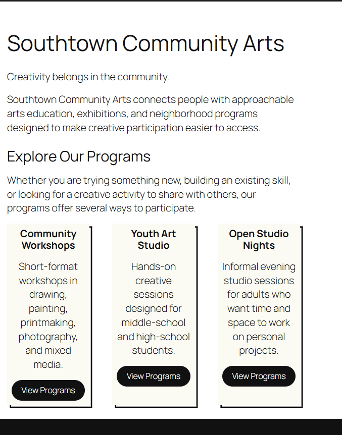
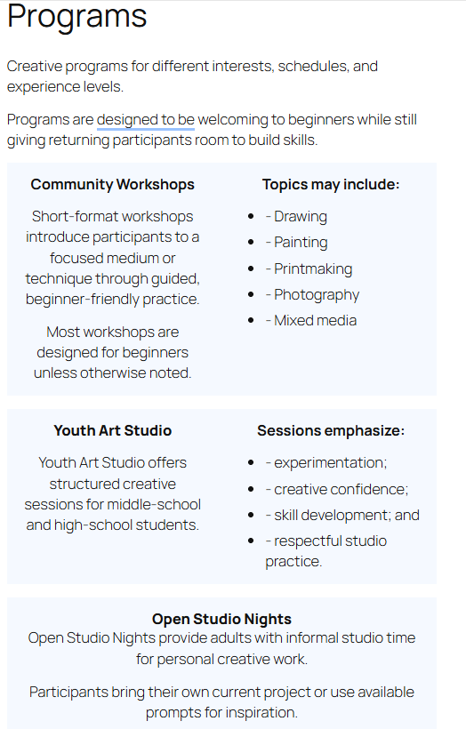
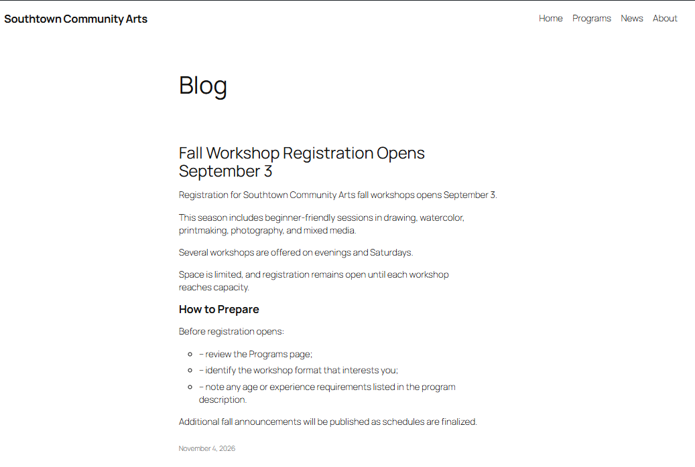
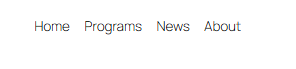
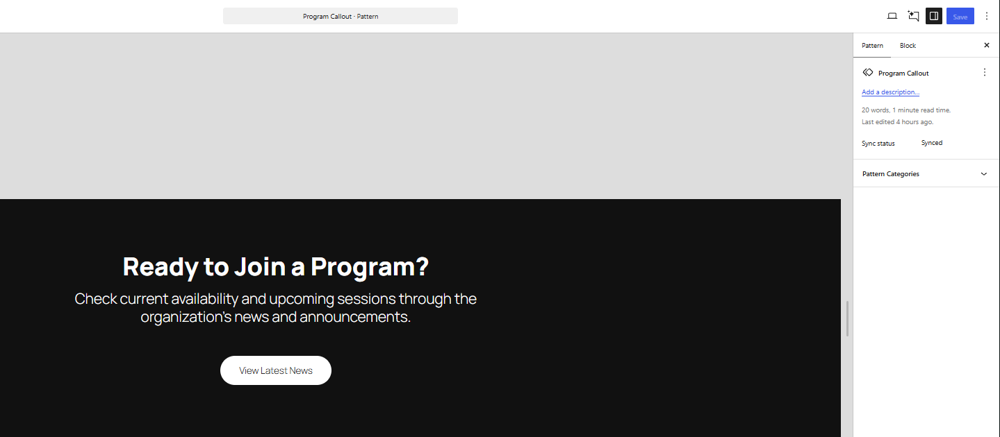
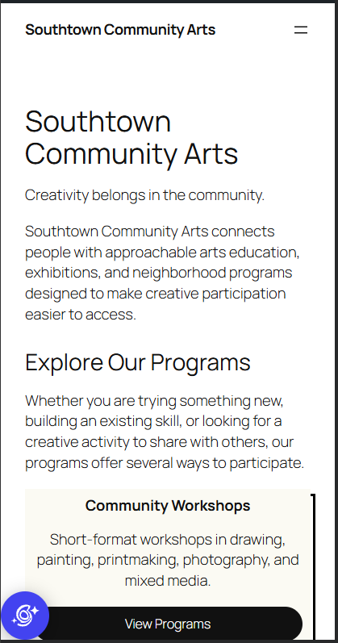

# Week 11: Build for Content — WordPress & CMS Fundamentals

## CMS Project Overview

**Client:** Southtown Community Arts  
**Role:** Junior Web / CMS Specialist  
**Week:** 11 — Build for Content: WordPress & CMS Fundamentals

Briefly summarize what you configured in WordPress.

i added 4 site pages and used one of the pages for posts to go to. i filled in the correct information through out the site for nav and footer.

---

## WordPress Site Access

**Site URL or instructor-access information:**  
https://susane32.sg-host.com

---

# Content Architecture

Explain how you organized the supplied client content.

## Pages

List the Pages you created and briefly explain why they belong as Pages.

- **Home:** its important to have a home page to welcome people and to instantly show what the site is about
- **Programs:** having a program page is needed, so that people can have access to the organizations programs that they are offering and what they are about.
- **About:** having an about page is needed because it tells the people more about the site and their goals etc.

## Post

**News Post:** Fall Workshop Registration Opens September 3

Explain why this content belongs as a Post rather than a Page.

its too short to be on a page and its a temporary thing, since it gets published on a specific date and is supposed to be removed after said date.
the title itself gives a good tone that it's an annoucment.

---

# Reusable Pattern

**Pattern Name:**  
Program Callout

**Used For:**  
i used this pattern for quickly reusing call-to-actions/

**Why a Pattern Was Appropriate:**  
it's appropriate because it allows things to be reused many times across the pages, making time shorter than having to recreate the same thing.

---

# Site-Wide Structure

Describe the required Site Editor change you completed.

**Change:**  
I added site navagations and site's info

**Where It Was Made:**  
Navigation, footer

**Why It Belongs at the Site Level:**  
the naviagation and footer needs to be consitent across multiple pages, because it's what allows the user to find their way across diffrent pages and to see the organization information.

---

# Client Update Test

Complete `CLIENT-UPDATE.md` after the primary site build, then document the result here.

## Supplied Update

Briefly identify the client change you completed.

I changed a text sentance on the program page

## Where I Made the Update

What WordPress content-editing area did you use?

the page content editor for the program page

## Structure Check

Did you need to modify the header, footer, navigation, template, template part, or reusable pattern? Explain.

no i didn't need to modify anything else, all i had to do was to edit the text alone.

## Maintainability Result

Explain how this update demonstrates that routine content can change without rebuilding the site's global structure.

the routine content can change without rebuilding the site's global structure by only editing the page itself and making sure that what you want to change is not site-wide edit.

---

# Accessibility & Responsive Checks

Document the quality checks you completed.

## Headings

i ordered the heading in their correct order of how it should be on a page

## Images

there was no images to add.

## Links & Buttons

I made sure every link and buttion had the proper text that shows where it's going to lead you to next when interacted with.

## Keyboard

i used my keyboard to test the sites navagation and focus and made sure everything was useable with a keyboard.

## Responsive Layout

I changed my browser sized and used the desktop-mobile size changer to test how certain things shrink and look on diffrent sizez and i made changes to certain things to keep them neat on the pages when the width changes.

---

# Evidence

Replace the files in the `evidence/` folder with your own screenshots using the exact required filenames.

## Home Page

## Programs Page

## News Post

## Primary Navigation

## Reusable Pattern

## Narrow-Screen / Mobile View

---

# Developer Handoff

Keep each response concise and specific to this project.

## CMS Choice

Why is WordPress an appropriate solution for Southtown Community Arts?

its an approprite solution because they need to be able to update the content and maintain it. wordpress is also a good solution since its quick and easy for the small changes.

## Editable Content

What information should Southtown Community Arts staff be able to update routinely?

the staff should be able to update everything since its just rewriting texts and creating new posts.

## Reusable Structure

What site element did you make reusable or site-wide, and why?

I made a resuable cta since i would be using the design site wide and the footer with its color design and info and the header.

## Client Protection

What design or architecture decision helps the site remain consistent when staff members make routine updates?

keeping the items in their proper sections allows things to keep their organized spots when edited and having reusable elements allow a quick and easy way to maintain a certain repeated design.

---

# Final Handoff Check

- [x] Home, Programs, and About are published as Pages.
- [x] The supplied announcement is published as a Post.
- [x] Primary navigation works in the required order.
- [x] One meaningful reusable Pattern is present.
- [x] The required site-wide structure adjustment is complete.
- [x] I completed the supplied `CLIENT-UPDATE.md` request after the main build.
- [x] The client update did not require unnecessary global-structure changes.
- [x] Headings are logical.
- [x] Informative images have meaningful alternative text.
- [x] Link and button labels are understandable.
- [x] Keyboard focus is visible.
- [x] Narrow-screen behavior was checked.
- [x] All six evidence images display correctly in this README.
- [x] All four Developer Handoff responses are complete.
- [x] I committed and pushed this Week 11 handoff folder.
