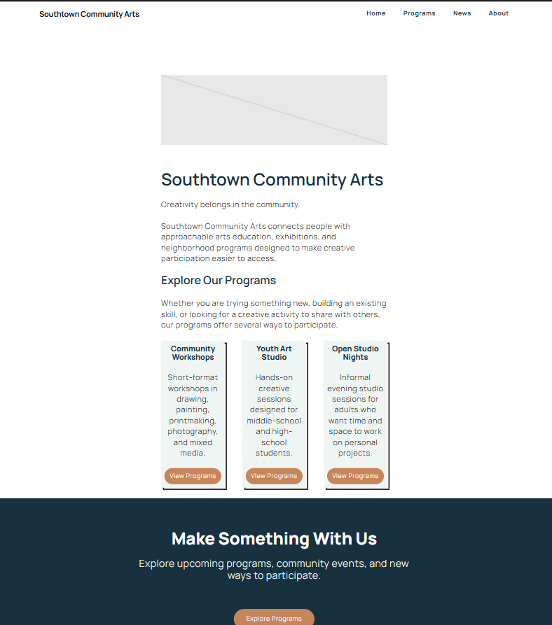
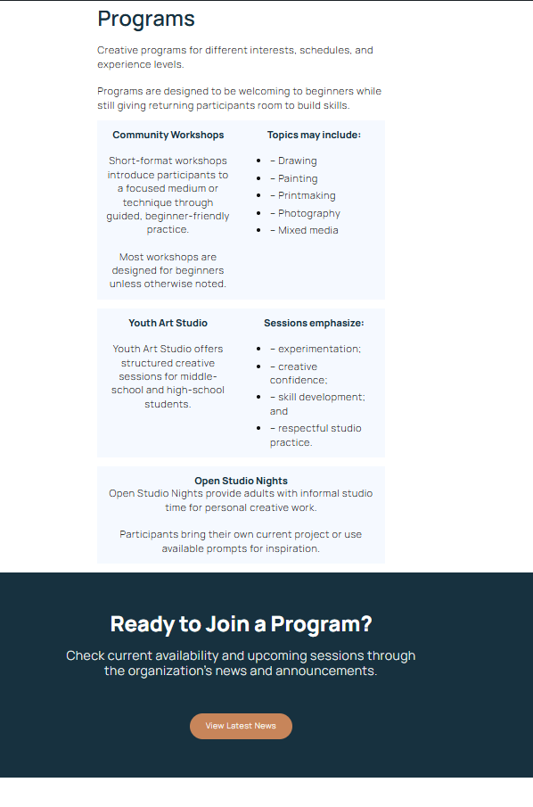
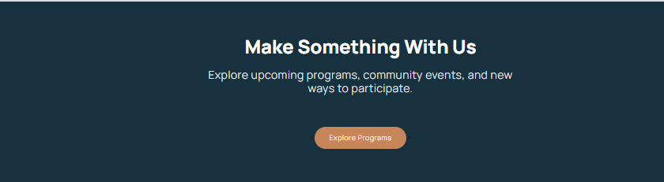
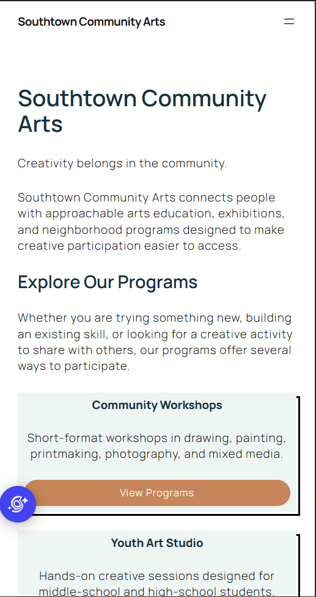
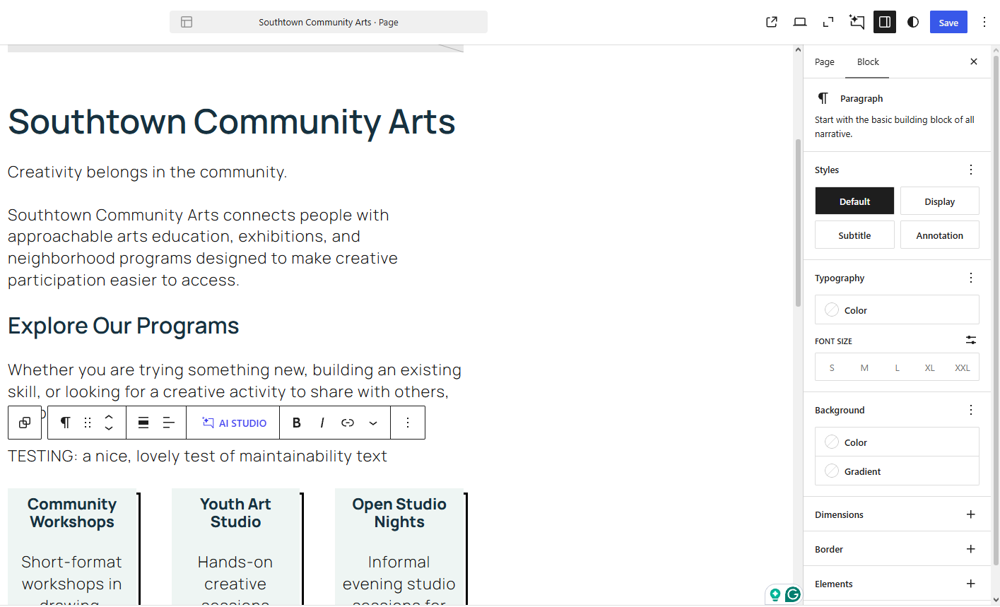

# Week 12: Customize the Experience — WordPress Development

**Client:** Southtown Community Arts  
**Role:** Junior WordPress Developer

## Project Overview

Briefly summarize how you customized the existing Week 11 CMS without making routine content harder for the client to maintain.

I added brand themed palltte allowing future editors to see the new fully named color palltte, added typograaphy and global layout spaceing and other customizations, while keeping everything else the same and easy to maintaine from week 11.

# Customization Decisions

Document the four required decisions below.

## 1. Global Design System

**Requirement:**  
brand pallete, typography, layoutspacing

**Location:**  
site editor Global Styles

**Change:**  
I changed the headers to be a semi bold with the southtown deep color so it stands out from others, i spaced the body texts by 1, gave the buttons the brand style color southtown warm. gave links a bolder look and southtown teal color with a southtown warm hover.

**Why this level:**  
is better at a global levelthen doing every page at a time because it allwos a quick and easy change across all the pages and

**QA:**  
[What did you test after the global change?]
i checked every page that exsits to see if the changes i made updated and shows corectly, and i looked around to make sure there wasnt bad contrasts with certain elements.

---

## 2. Branded Reusable Pattern

**Pattern:**  
Webwork cta

**Change:**  
I added the brand colors to the cta's

**Reuse:**  
i reused it on the about, program, and home page.

**Editor value:**  
[How does this help a future editor update content without rebuilding the design?]
this helps future editors keep the same design layout and color theme.

---

## 3. Site-Wide Structure Customization

**Shared area:**  
footer

**Change:**  
i changed the footer with the brand colors

**Why this level:**  
the footer change needed to be on every page at once, so this level had fit the job best

**QA:**  
i checked every page that exists to double make sure my changes went through.

---

## 4. Controlled Development-Level Modification

Complete **one** option.

**Option used:**  
[theme.json OR targeted CSS]

**Location:**  
[Where the modification lives in the supplied environment.]

**Code / configuration snippet:**

```text
Paste only the small relevant snippet here.
```

**Reason:**  
[What legitimate requirement could not be solved cleanly through the available editor/global controls?]

**Documentation:**  
[Which official WordPress reference helped you understand the change?]

**QA:**  
[How did you verify the change worked without creating new problems?]

---

# Visitor + Editor QA

## Visitor Experience

- [x] I tested narrow and wide viewport behavior.
- [x] I checked visual consistency on more than one page.
- [x] I checked text/link/button contrast.
- [x] I verified visible keyboard focus.
- [x] I tested navigation and links.
- [x] I checked that the brand system is consistent rather than page-specific.

### Visitor QA Notes

[Briefly describe one issue you found or one important verification you made.]
one issue i found was one of the buttons layout did not match the rest, so i had had to go back into edit and fix it, so now in visitor mode when changeing sizes the buttons adjust properly responding to the veiw ports.

## Editor Experience

- [x] Routine content is still editable through WordPress.
- [x] The branded pattern is understandable to reuse/edit.
- [x] My customization did not move ordinary client content into code.
- [x] I performed one temporary routine content edit, previewed it, and restored the original content.
- [x] The site remained visually coherent after the editor test.

### Editor QA Notes

[Briefly describe the update you tested and what you verified.]
i tested the editor-maintainability by adding in temporary text to make sure future editors can easily edit with out having to heavily modifiy something.

---

# Evidence

Use the exact filenames below.

## Customized Home



## Customized Programs



## Branded Reusable Pattern



## Responsive / Mobile View



## Editor Maintainability Test



---

# Maintainability Reflection

Write approximately **75–100 words** responding to:

> Give one example of a change you intentionally handled globally and one change you intentionally left as editable content. How does that separation help Southtown Community Arts maintain the site without losing design consistency?

i handled the brand theme and some of the layout spacing gloablly and i left the text sections for all pages easy to be editable without those future edits being able to break the design layout or brand color theme, i also left the cta as editable content so editors can easilt reuse the design across diffrent pages and customize it to ach pages theme.
this seperation allows the brands theme which is global not be messed up when performing page edits and it makes it easy to keep the brand them going when adding new pages, and when left as editable content it allows future editors to change spesific things to that certain page easily.

---

# Final Handoff Check

- [x] I continued the Week 11 Southtown site rather than rebuilding it.
- [x] I applied the approved palette and typography direction systematically.
- [x] I used global controls for global decisions.
- [x] I created or significantly customized one branded reusable pattern.
- [x] I made one appropriate site-wide structure customization.
- [x] I completed exactly one controlled development-level modification.
- [x] I did not add PHP, plugins, custom blocks, or a child-theme build for this assignment.
- [x] Visitor and editor QA are complete.
- [x] All five evidence screenshots display in this README.
- [x] I completed the maintainability reflection.
- [x] I committed and pushed the Week 12 handoff folder.
